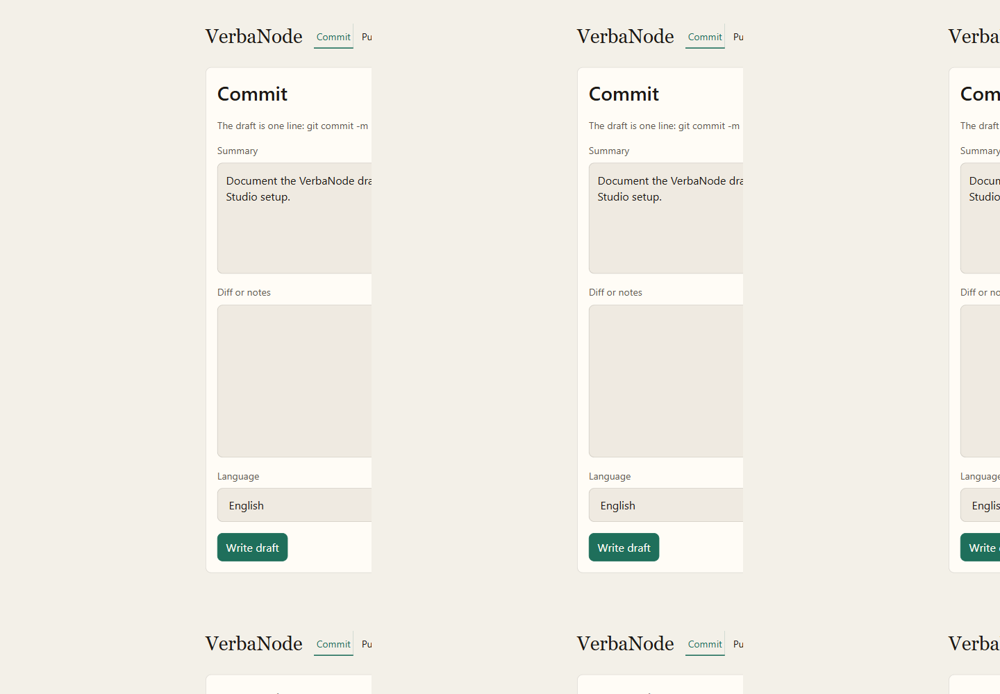
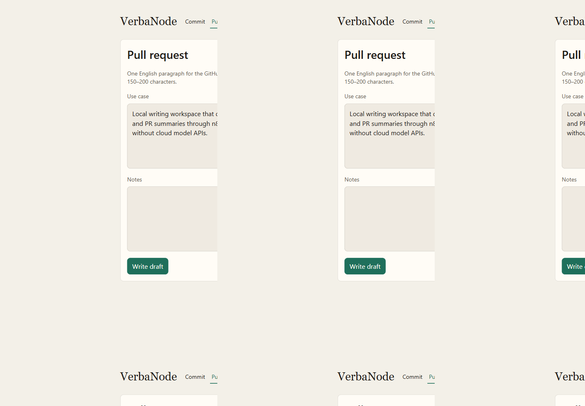
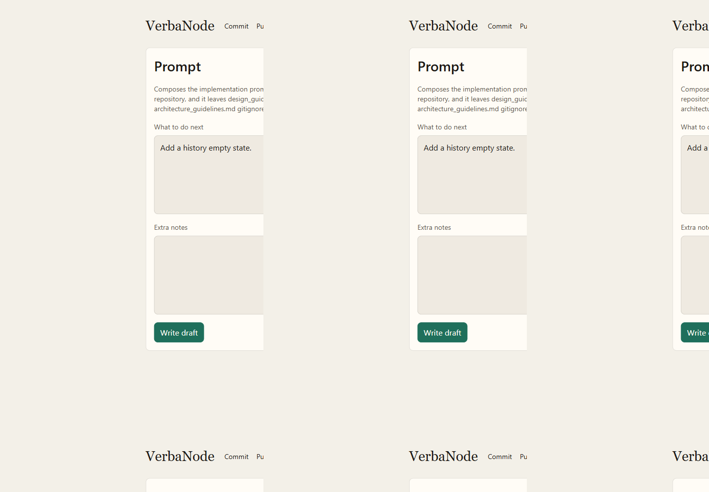
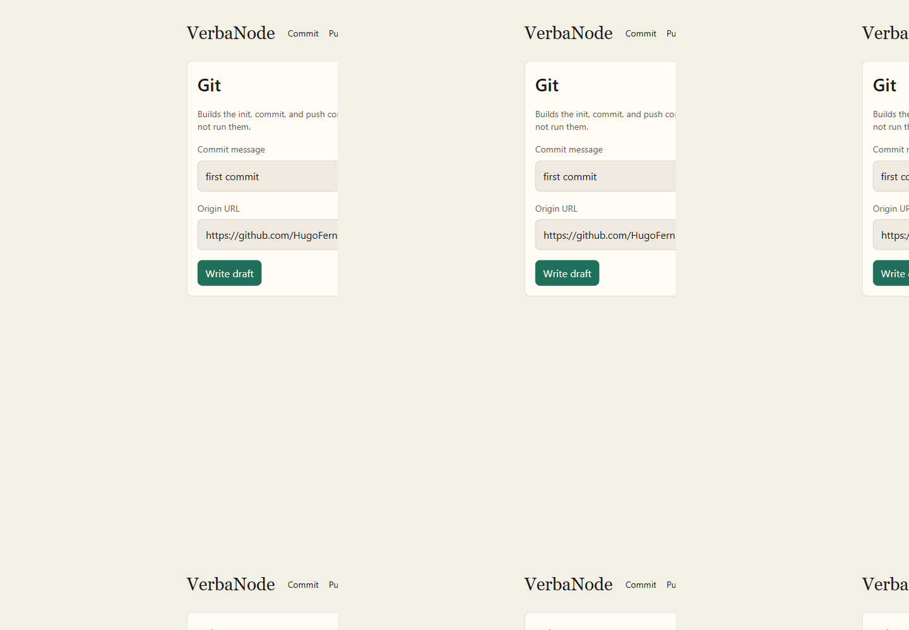
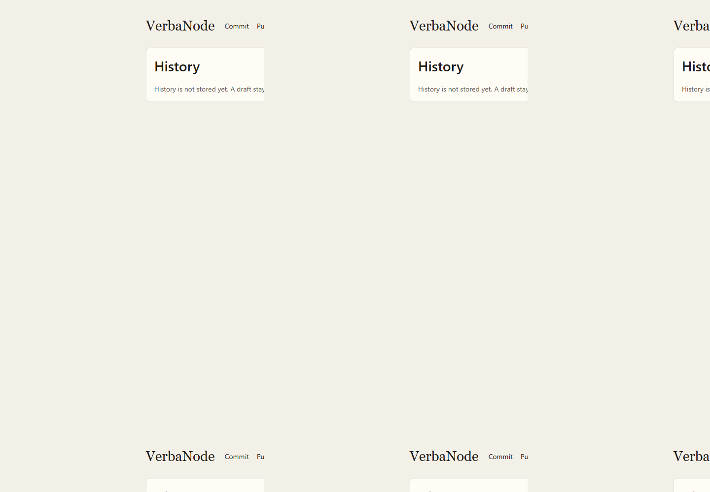

# VerbaNode

Local drafts for four writing tasks: a `git commit -m` line, a short English pull request summary, an implementation prompt, and the git init/push command list. Docker Compose runs n8n. LM Studio runs **liquid/lfm2.5-1.2b** for the two tasks that need a model. The prompt and git tasks fill a template and do not call the model. Nothing in the generation path calls a paid cloud model API, and the Git screen does not run git.



## Author

Hugo Fernando Colmenares — [github.com/HugoFernandoColmenares](https://github.com/HugoFernandoColmenares)

## Screenshots

| Task | Preview |
| --- | --- |
| Commit |  |
| Pull request |  |
| Prompt |  |
| Git |  |
| History |  |

## What runs where

| Process | Where it runs | Port on this machine |
| --- | --- | --- |
| LM Studio, model `liquid/lfm2.5-1.2b` | Host desktop app. Not a container. | `1234` |
| n8n | Docker Compose service `n8n` | `127.0.0.1:5678` |
| Angular (`verbaNodeApp`) | Host, `ng serve`, until a production image exists | `4200` |

The browser talks only to n8n. n8n talks to LM Studio at `http://host.docker.internal:1234/v1`. A container cannot use the host's `127.0.0.1`.

## Layout

```text
VerbaNode/
├── docker-compose.yml          # n8n only
├── .env.template               # committed keys
├── .env                        # local values, gitignored
├── docs/
│   ├── files/                  # technical guidelines (English)
│   └── screenshot/             # captures for those guidelines
└── verbaNodeApp/               # Angular 22 workspace
    └── docs/
        ├── files/              # UI architecture and design
        └── screenshot/
```

## Documentation

Start at [docs/files/guidelines.md](docs/files/guidelines.md).

| Topic | File |
| --- | --- |
| Scope and doc map | [docs/files/guidelines.md](docs/files/guidelines.md) |
| System architecture | [docs/files/architecture.md](docs/files/architecture.md) |
| Compose, network, volumes | [docs/files/docker.md](docs/files/docker.md) |
| n8n webhook contract | [docs/files/n8n.md](docs/files/n8n.md) |
| LM Studio | [docs/files/lmstudio.md](docs/files/lmstudio.md) |
| SQLite persistence | [docs/files/sqlite.md](docs/files/sqlite.md) |
| Angular modules and data flow | [verbaNodeApp/docs/files/architecture_guidelines.md](verbaNodeApp/docs/files/architecture_guidelines.md) |
| Visual design | [verbaNodeApp/docs/files/design_guidelines.md](verbaNodeApp/docs/files/design_guidelines.md) |

## Prerequisites

- Docker Desktop, with Compose v2
- LM Studio on this workstation, with **liquid/lfm2.5-1.2b** loaded
- Node.js and npm, for `verbaNodeApp` (npm 12 is recorded in `package.json`)

## First boot

1. Copy the template if `.env` is missing: `copy .env.template .env`
2. Replace `N8N_ENCRYPTION_KEY` with a long random string. Keep that value. Changing it later makes saved n8n credentials unreadable.
3. In LM Studio, load **liquid/lfm2.5-1.2b**, start the local server, and allow the server to be reached on the local network. Confirm the model id:

```text
curl.exe http://127.0.0.1:1234/v1/models
```

If the id differs, set `LMSTUDIO_MODEL` in `.env` to the id LM Studio returns, then restart the n8n container.

4. Start the orchestrator:

```bash
docker compose up -d
```

5. Open the editor at [http://localhost:5678](http://localhost:5678). The Angular workspace, from `verbaNodeApp`:

```bash
npm start -- --host 127.0.0.1 --port 4200
```

Then open [http://127.0.0.1:4200](http://127.0.0.1:4200).

## Import the workflow

After the editor has an owner account:

```text
docker compose cp n8n/workflows/verba-draft.json n8n:/tmp/verba-draft.json
docker compose exec n8n n8n import:workflow --input=/tmp/verba-draft.json
docker compose exec n8n n8n list:workflow
```

Publish it with the id from that list, then restart n8n so the webhook registers:

```text
docker compose exec n8n n8n publish:workflow --id=<id>
docker compose restart n8n
```

Prefer a single published workflow. Re-importing without a stable id creates duplicates.

The production webhook is `POST /webhook/verba/draft`. The Angular dev server proxies `/webhook` to `127.0.0.1:5678`, so the browser stays on port 4200.

`prompt` and `git` work without LM Studio. `commit` and `pr` need the model loaded and the local server reachable from the container.

## Status

| Piece | State |
| --- | --- |
| Compose file, env contract, docs | Present |
| n8n workflow file | `n8n/workflows/verba-draft.json` |
| Angular task screens | Present |
| Screenshots | `docs/screenshot/` |
| Angular production image | Not created |
| Draft history table | Not created |
